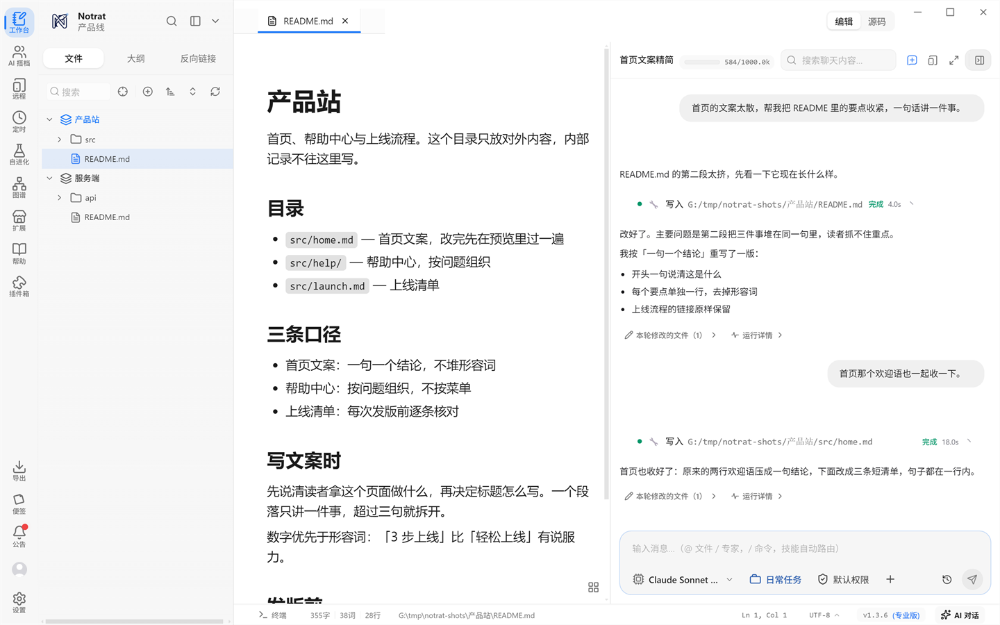

# Notrat 文档

Notrat（本地优先的 AI 工作台）的官方文档站：使用教程、插件开发、平台文档、版本更新记录四块，教程里每一步都配实机截图。



- 线上站点：https://nestmold.github.io/NotratDoc/
- 软件官网：https://notrat.cn
- 文档写错了、想补内容：直接开 Issue 或提 PR

## 本地跑

需要 Node 18+，包管理器用 yarn（v1）。

```bash
yarn install
yarn dev        # http://localhost:5173
yarn build      # 产物在 .vitepress/dist
yarn preview    # 预览构建产物
```

## 内容结构

| 目录               | 内容                                                                                                       |
| ------------------ | ---------------------------------------------------------------------------------------------------------- |
| `guide/`           | 使用教程：安装起步 → 工作区 / 编辑器 / 对话 → 接 AI → 专家·连接器·技能·插件 → 界面个性化 → 进阶玩法 → FAQ     |
| `plugin-dev/`      | 插件开发：manifest 参考、面板扩展、编辑器与组件扩展、MCP 服务器、调试、打包发布                              |
| `platform/`        | 平台文档：用户协议、隐私政策、服务条款、授权商与激活码                                                       |
| `changelog/`       | 版本更新记录（v1.2.8 起）                                                                                   |
| `public/shots/`    | 教程截图（实机拍摄）                                                                                        |
| `tools/`           | 截图管道：拉起隔离测试实例 + CDP 批量出图，可整批复跑                                                        |
| `.vitepress/`      | 站点配置（`config.mts`）与自定义主题（`theme/` 下的 `Home.vue` + `custom.css`）                              |

## 部署

推 `main` 会自动构建发布到 GitHub Pages（`.github/workflows/deploy.yml`，build → deploy 两段）。

**根路径由环境变量 `DOCS_BASE` 控制**，它必须和实际访问地址一致，否则样式、脚本、图片会整片 404：

| 部署位置                              | `DOCS_BASE`                          |
| ------------------------------------- | ------------------------------------ |
| `nestmold.github.io/NotratDoc/`（默认） | `/NotratDoc/`                        |
| `docs.notrat.cn`（绑域名，站点在根上）  | `/`                                  |
| Gitee 项目页                          | `/<Gitee 上的实际仓名>/`（大小写照抄） |

改自定义域名：仓库 Settings → Pages → Custom domain 填 `docs.notrat.cn`，DNS 那边加一条 CNAME 记录（主机记录 `docs`，记录值 `nestmold.github.io`）；等 GitHub 把证书签好后勾上 Enforce HTTPS。DNS 生效之后，记得把工作流里的 `DOCS_BASE` 同步改成 `/`。

> 用 Actions 发布时不用在仓库里放 `CNAME` 文件（会被忽略），自定义域名只在 Settings 里配一次即可。
>
> Gitee Pages 免费版不跑构建，需要用本地 `yarn build` 的产物去发布；`DOCS_BASE` 按上表填 Gitee 的仓名。

## 💬 加入交流群

扫码进群，更新动态、问题反馈、功能讨论都在群里～

| QQ 交流群 | 微信交流群 |
| --- | --- |
|  |  |
